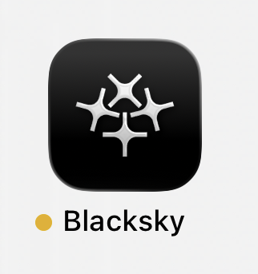

# Blacksky Mobile App


The mobile app, once you go through the steps below for your particular device, should look like the image below.


<figure><figcaption></figcaption></figure>

### iPhone & iPad (TestFlight)

Apple distributes betas through a free app called [TestFlight](https://testflight.apple.com/join/ST8N2Qda). You'll install that first, then use it to install our app.

**Steps**

1. Open the App Store and install the app called [TestFlight](https://testflight.apple.com/join/ST8N2Qda) (made by Apple). It's free.
2. Open the [invitation link](https://testflight.apple.com/join/ST8N2Qda) on your iPhone or iPad. It will open in TestFlight automatically.
3. Tap Accept, then tap Install.
4. Once installed, open the app from your home screen like any other app.

### Getting updates


New test versions arrive through the TestFlight app, not the regular App Store. Open TestFlight and tap Update if one is available. You can turn on automatic updates inside TestFlight, so you always have the latest build.


**If something goes wrong**

* Tapping the link does nothing? You almost certainly haven't installed TestFlight yet. Install it first (Step 1), then tap the link again.
* "This beta isn't accepting new testers" means the tester limit (10,000) is full, or the invite window has closed.


If this occurs, please contact us [support@blacksky.app](mailto:support@blacksky.app).


* The app suddenly won't open and shows an expiry message? Test builds expire after 90 days. Open TestFlight and install the newest version, or contact us for a fresh build.
* Make sure your device's iOS version is up to date — older versions may not be able to install the beta.

## Android (Google Play)

On Android, there's no separate app to install. If you are on your phone, you can directly download the app. If you are on a laptop, you can opt-in to testing from a browser which will download the app onto your phone. The process is simpler for joining using your phone.

**Steps (on phone)**

1. Click [this link](https://play.google.com/store/apps/details?id=community.blacksky.app) for joining on your phone.
2. You should be redirected to Blacksky’s Play Store listing.
3. Tap Install (or Update). The app downloads like any normal app.

**Steps (on desktop)**

1. Make sure you're signed in to the Play Store with the same Google account on your phone that you'll use for the link.
2. Open [this link](https://play.google.com/apps/testing/community.blacksky.app) and tap "Become a tester."
3. Tap the link on that page to open the app's Play Store listing.
4. Tap Install (or Update). The app downloads directly onto your phone.

**Getting updates**


Updates come through the Play Store automatically, just like any other app — no extra steps needed.


If something goes wrong

* "Item not found" or the listing won't load? This is almost always temporary. A new beta can take a few hours to go live after we publish — wait a bit and try again.
* Still can't find it? Double-check you're signed in with the exact Google account you used to opt in. A mismatched account is the most common cause.
* If you accepted the invite on a computer, the app should appear on your phone within a few minutes as long as it's the same Google account.


If you were part of an earlier private/closed test, you may need to leave that first before joining the open beta.


### Need a hand?

If you're stuck after trying the steps above, reach out and include:&#x20;

* Device type
* OS (operating system)  version&#x20;
* A screenshot of what you're seeing

Send this to [support@blacksky.app](mailto:support@blacksky.app).

\
Reporting Bugs and Sending Feedback
-----------------------------------

#### iPhone & iPad (TestFlight)

To report bugs and crashes, follow these instructions.&#x20;

**For crashes:**

If the app crashes, you should get a prompt to share a crash report with the developer. Please fill in as many details as you can about what you were doing on the app before it crashed and hit submit.

**For bugs:**

There are two paths to reporting bugs in the app:\
1\. Screenshot: Take a screenshot of the bug in the app, tap on the screenshot, hit Share, and then tap “Share Beta Feedback”. You will have the ability to add details to accompany the screenshot shared with us, please fill in the description with anything you think may be relevant.

2\. Testflight: Open Testflight, tap on Blacksky, and hit “Send Feedback”.&#x20;

#### Android

To report any bugs or provide feedback: open the Play Store, tap on the profile icon, click on "Manage apps and devices" and then click on "Beta", find Blacksky in the list and tap on it, then under "Private Feedback to the Developer" tap "Write Feedback" and describe your feedback in the text box

 
